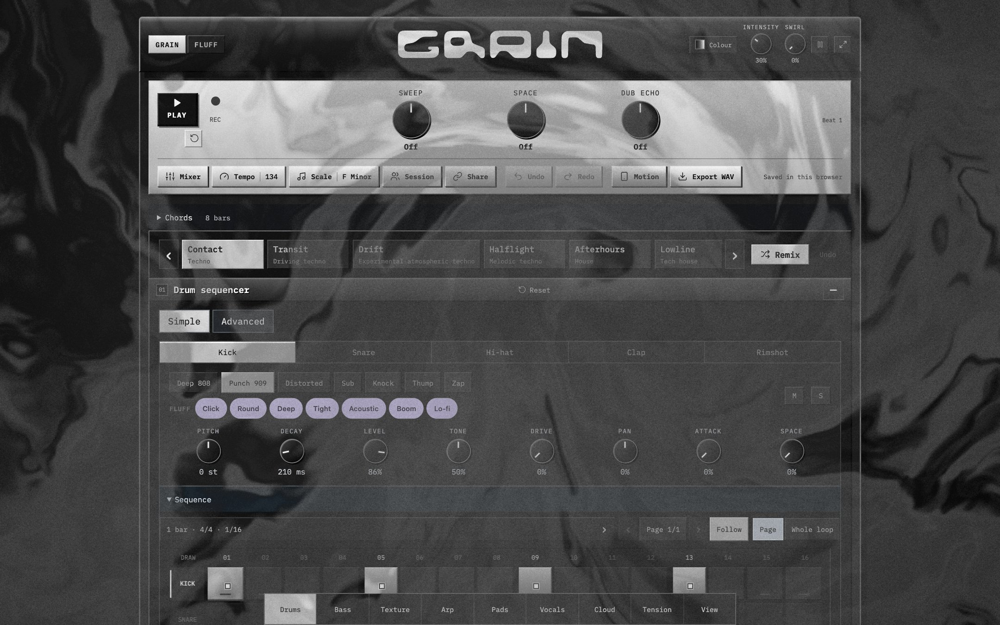
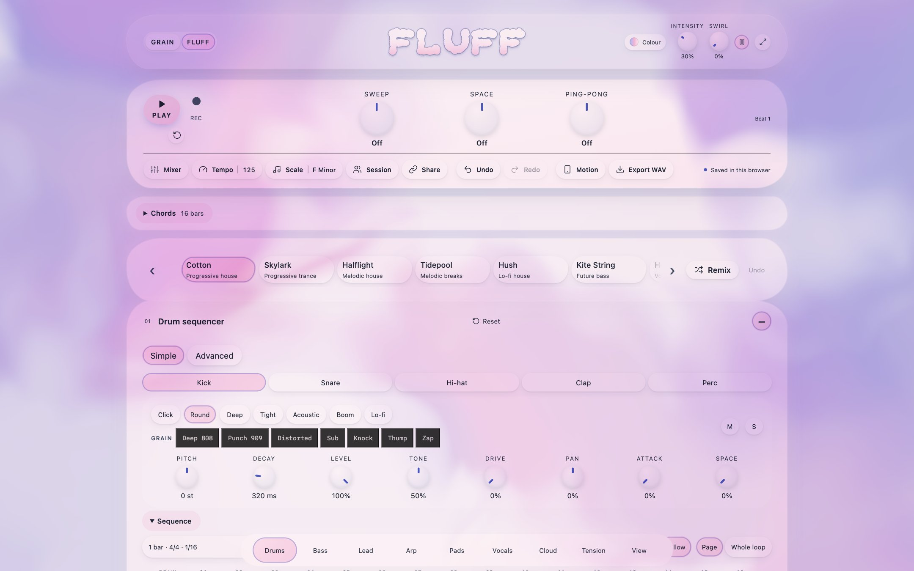
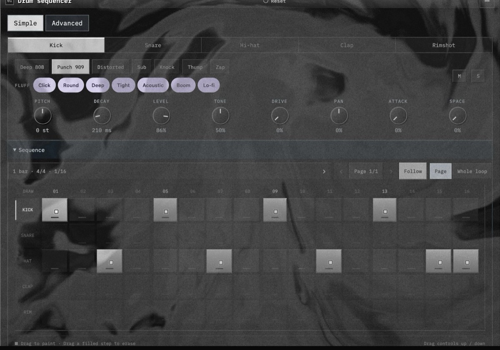
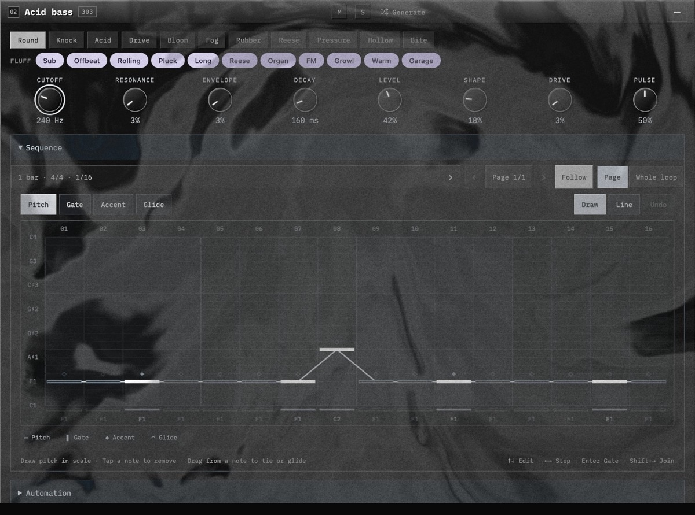
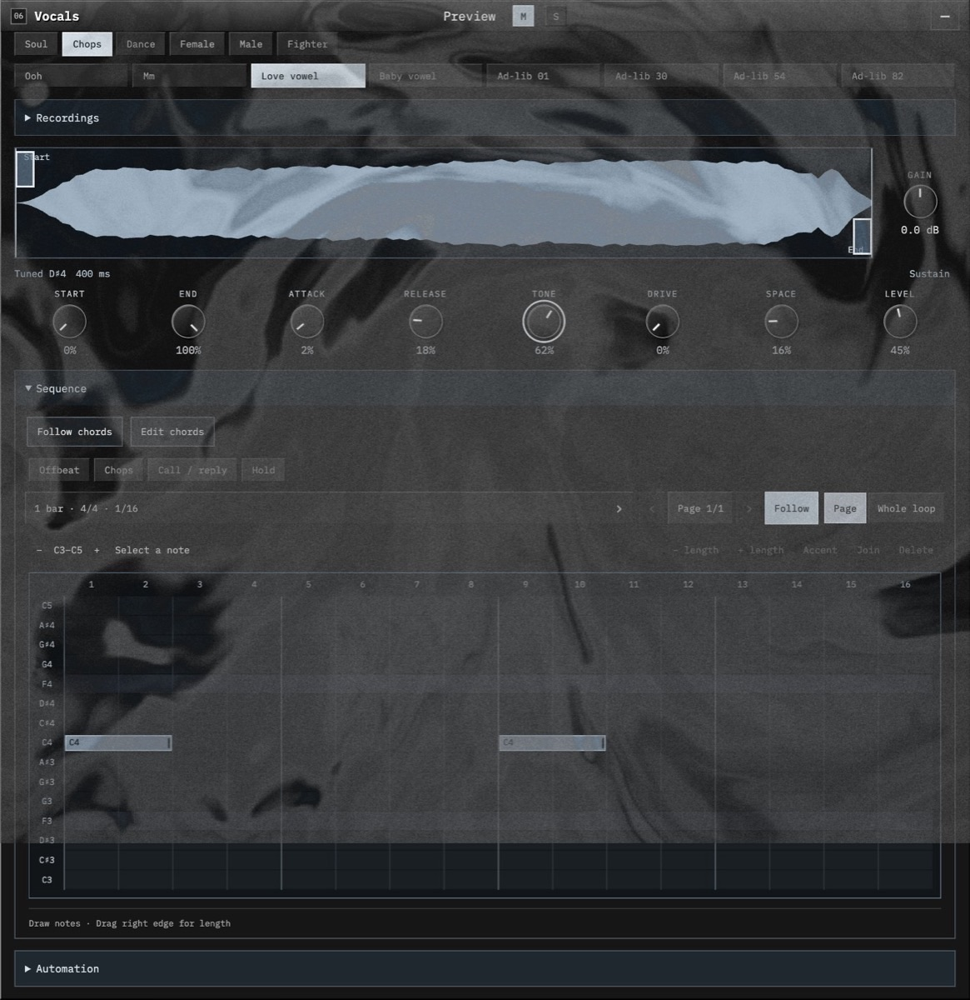
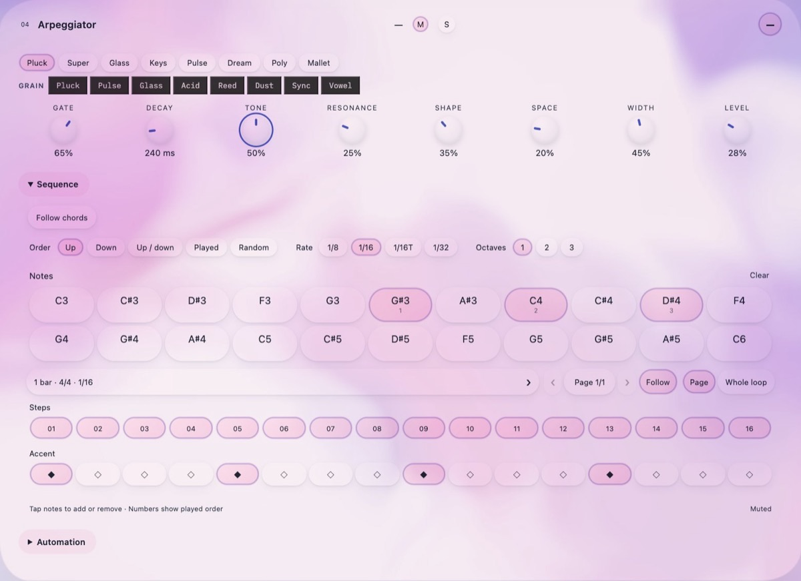
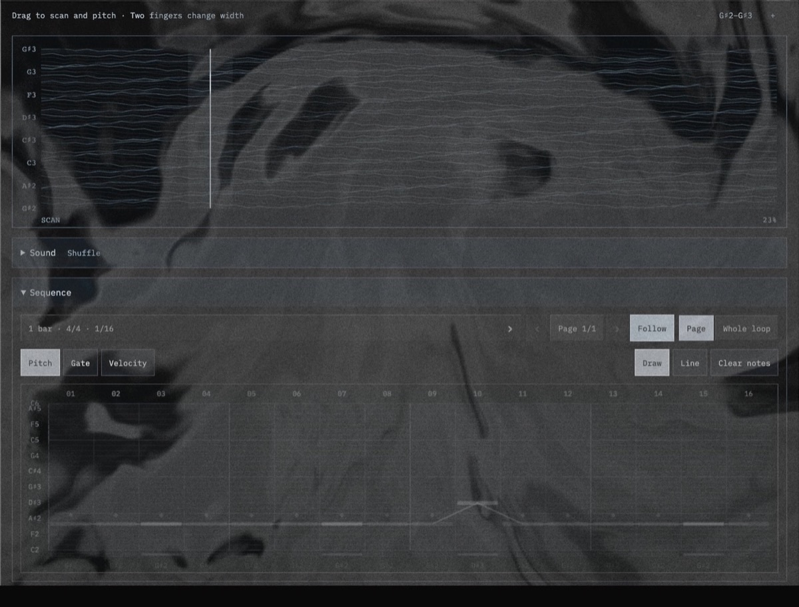
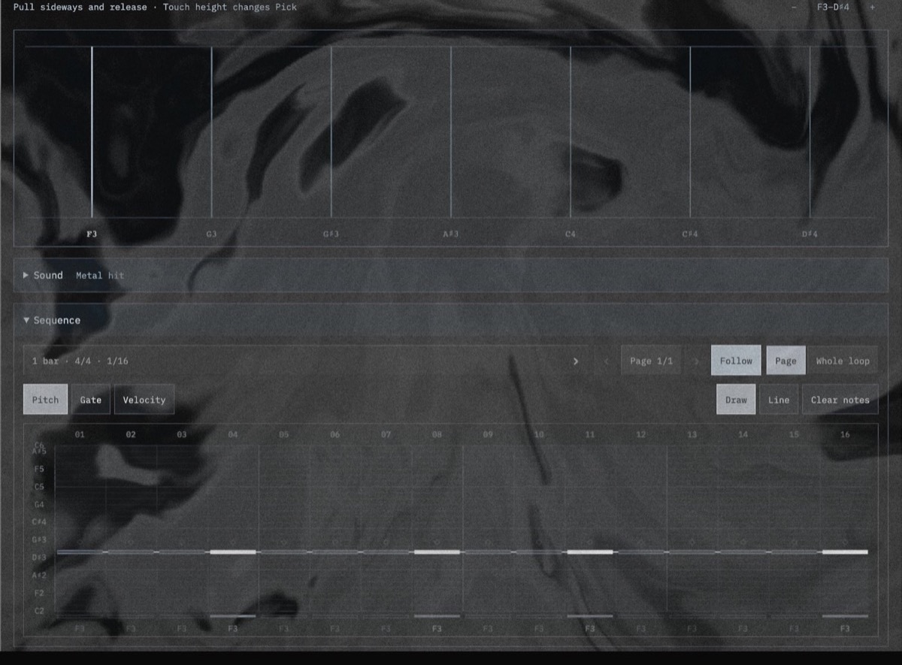
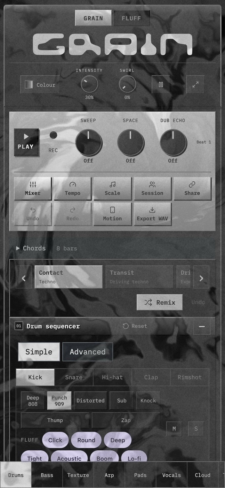
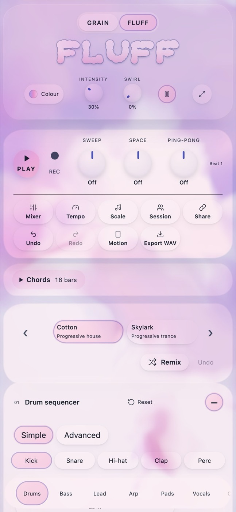

<div align="center">

# Grain

A drum machine and synth studio that runs in your browser. No install, no account.

<a href="https://acid-303.pages.dev/"></a>

## [acid-303.pages.dev](https://acid-303.pages.dev/)

<a href="https://acid-303.pages.dev/"></a>

</div>

## What you get

- **Eight instruments**: five-lane drum machine, 303-style acid bass, Texture, Arpeggiator, Chord pads, Vocal sampler, Cloud (granular) and Tension (tuned resonator).
- **Draw everything**: paint drum steps, draw pitch, gate, accent and glide, and draw automation for every knob. Notes stay locked to your chosen scale.
- **21 genre examples** from house and techno to jungle and UK bass, plus Remix for a fresh pattern.
- **Fluff mode**: a second, melodic studio for trance, progressive house and melodic breaks, with 17 more examples.
- **Play together**: live sessions for one host and up to seven guests. Guests edit; audio plays only on the host's device.
- **Share and export**: compressed track links, WAV export, Undo/Redo, and projects saved in your browser.
- **Phone-ready**: multi-touch drawing, and tilt or move your phone to turn a knob.

## Two studios

Switch between **Grain** and **Fluff** in the title bar. Each has its own sounds, effects, examples and look; the sequencers and your project carry over. Any track can also use the other studio's sounds.

<a href="https://acid-303.pages.dev/"></a>

## Instruments

<table>
  <tr>
    <td width="50%" valign="top"><br><b>Drums</b>: paint steps across kick, snare, hat, clap and rim, each with eight automatable controls.</td>
    <td width="50%" valign="top"><br><b>Acid bass</b>: draw pitch, gate, accent and glide in scale.</td>
  </tr>
  <tr>
    <td valign="top"><br><b>Vocals</b>: trim a sung or chopped sample and draw notes of any length.</td>
    <td valign="top"><br><b>Arpeggiator</b>: pick notes, order, rate and octaves, or follow the chord progression.</td>
  </tr>
  <tr>
    <td valign="top"><br><b>Cloud</b>: drag to scan granular material and change pitch.</td>
    <td valign="top"><br><b>Tension</b>: pull and release strings to strike tuned percussion.</td>
  </tr>
</table>

## On your phone

<p align="center">
  
  &nbsp;&nbsp;
  
</p>

## Documentation

- [User guide](docs/guide.md): every control, gesture and keyboard shortcut
- [Fluff mode](docs/fluff.md): the second studio and its sounds
- [Chords and composition](docs/composition.md)
- [Shared sessions](docs/sessions.md)
- [Samples and licences](docs/samples.md)

## Development

Requires Node 22.12 or later.

```bash
npm install
npm run dev
```

`npm test` runs unit checks and `npm run test:e2e` runs browser checks (requires Chrome). See [development](docs/development.md) for the code structure and [deployment](docs/deployment.md) for release steps.

## Made with AI

The code, documentation, example patterns and synthesized sounds in this repository were generated almost entirely by AI coding agents, directed by the author. They can contain errors.

## Licence and credits

Original work in this repository is dedicated to the public domain under [CC0 1.0](LICENSE), without warranty. Third-party material keeps its own terms:

- **Drum samples**: the Sonic Pi sample library (recordings from freesound.org) and Virtuosity Drums by Versilian Studios and Karoryfer Samples, all CC0 1.0. [Per-file sources](docs/samples.md)
- **Vocal samples**: Kenney's Voiceover Pack and Voiceover Pack (Fighter), performed by Giselle and Jeffrey M. Smith, and Producer Space's Soulful House Vocals, Euphoric Trance Vocals and Dance Vocal Shouts, all CC0 1.0. [Credits](public/vocals/README.txt) · [Licences](public/vocals/licenses)
- **Typeface**: IBM Plex Mono, SIL Open Font License 1.1.
- **Icons**: Lucide, ISC licence, with portions from Feather under the MIT licence.
- **Wordmark**: the GRAIN wordmark is traced from a reference lettering image and is outside the dedication. [Title reference](docs/title-reference.md)
- **Title-font studies**: cuts 21–30 in `design/title-font-studies/` derive from other typefaces and stay under the SIL Open Font License 1.1. [Credits](design/title-font-studies/ROUND-3-CREDITS.txt)
- **npm dependencies** keep their own licences.
